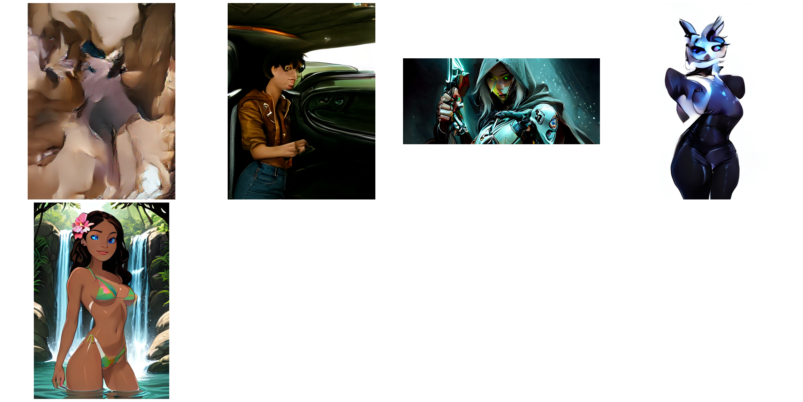
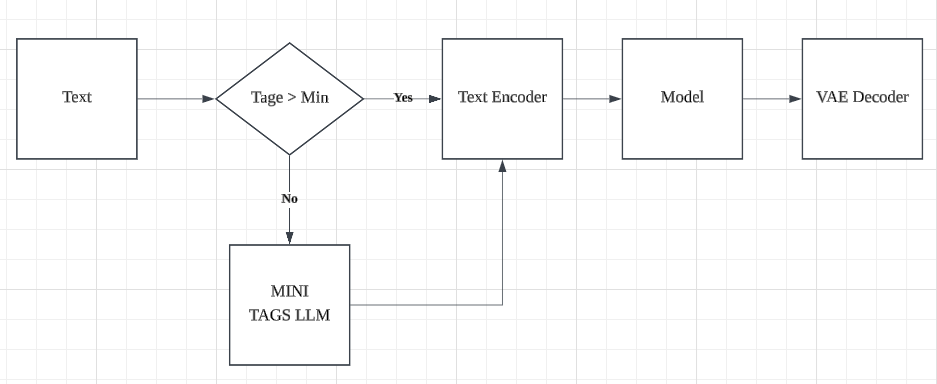
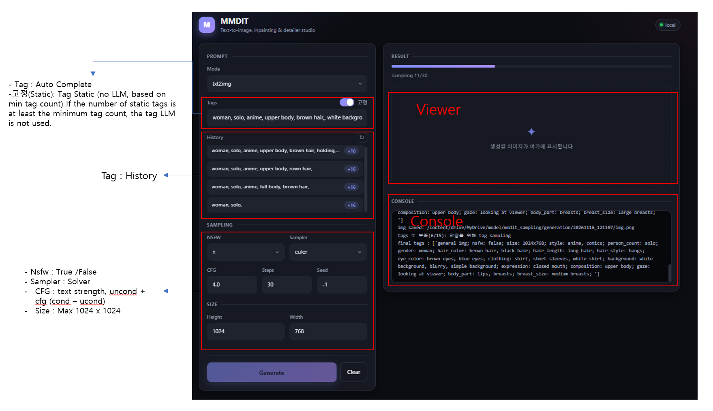
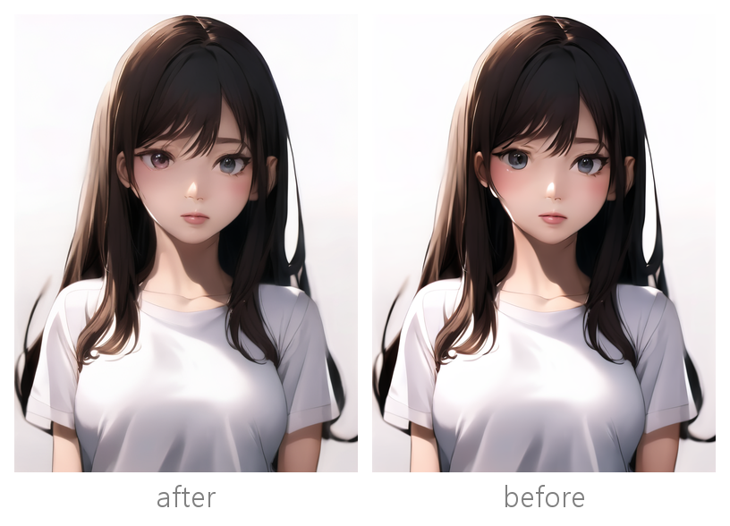

# Diffusion MMDiT with DC-AE f32c32

## Update — 2026.11.17 Sampling

### Sampling Improvements

- **DDIM sampler removed**
  - Removed the standalone DDIM sampler due to unsatisfactory generation quality in the current implementation.

- **Noise Injection added to Euler and Heun**
  - Introduced additional noise injection during the sampling process.
  - Prevents the sampling trajectory from becoming overly constrained by the initial latent structure.
  - Allows the model to reconstruct local features while better utilizing surrounding image context.
  - Improves structural consistency across neighboring regions.

- **`eta` parameter (noise injection strength)**
  - Each step integrates only down to `σ_lo = σ_next × (1 − eta)`, then re-noises back up to `σ_next` with fresh noise.
  - `eta = 0`: no noise injection. Identical to the original Euler / Heun / DDIM behavior.
  - Higher `eta`: a larger back-and-forth interval per step, so more of the previous structure is re-noised and re-decided.
  - Too high: details and composition can drift between steps, and Heun's second-order correction covers a shorter interval, so its benefit shrinks.
  - Suggested starting range: `0.1 ~ 0.3` (default `0.3` for DDPM_PLUS). Tune per step count and CFG scale.
  - The final step never injects noise, regardless of `eta`.

### Quality Improvements

- Improved eye and facial detail reconstruction.
- Better consistency between left and right facial features.
- Improved transitions between modified and preserved regions.
- Reduced local structural artifacts.
- Significant quality improvements in realistic image generation and inpainting.

### Available Samplers

| Sampler | Status | Uses `eta` |
|---|---|---|
| Euler + Noise Injection | Supported | Yes |
| Heun + Noise Injection | Supported | Yes |
| DDPM_PLUS | Supported | Yes |
| DDIM | Removed | - |

### Notes

Noise injection improves the model's ability to reconstruct local structures instead of relying too heavily on the initial latent representation.

This is particularly beneficial for realistic image generation, where fine details and spatial consistency are important.

## Inference Requirements
- **Inference:** Min VRAM 15GB
- **Storage:** Min 30GB free disk space (excluding `requirements.txt` packages)
- **Environment:** Local & Google Colab supported

## Update 2026 11 16 Sampling GPU Optimize
### CPU Offloading Mode

If your GPU has less than 15GB VRAM, run inference in CPU offloading mode.
The model stays on CPU; transformer blocks are streamed to the GPU in chunks.

On startup, choose `n`:

```
model upload on gpu (y or n): n
```

Then set the chunk size (layers loaded onto the GPU at once):

```
block chunk size (1~8, recommended 4):
```

| CHUNK | Layers on GPU | With prefetch | Approx. VRAM |
|-------|---------------|---------------|--------------|
| 1     | 1             | 2             | ~0.5GB       |
| 2     | 2             | 4             | ~1.1GB       |
| 4     | 4             | 8             | ~2.2GB       |
| 8     | 8             | 16            | ~4.3GB       |

- Larger chunk = faster, more VRAM.
- Smaller chunk = safer on low VRAM.
- Up to `2 × CHUNK` layers are resident with prefetch.

Trade-off: VRAM drops from ~15GB to ~3GB, but inference is slower due to
CPU-GPU PCIe transfers. Output quality may also be slightly lower than full
GPU mode (differences in floating-point precision and kernel accumulation
order across CPU↔GPU transfers).

## Installation
```bash
python -m pip install -r requirements.txt
```


## Architecture

- **Autoencoder:** DC-AE f32c32 (32× compression, 32 latent channels)
- **Text Encoder:** T5-Large
- **Backbone:** MMDiT with Joint Attention
- **Implementation:** Custom implementation (no pretrained base model)
- **Parameters:** 4B

## Train Environment

- **Framework:** PyTorch (no custom CUDA kernels)
- **GPU:** NVIDIA RTX PRO 6000 (96GB VRAM)
- **Platform:** Google Colab

## Training

### Configuration

- **Batch Size:** Micro-batch 4 × Gradient Accumulation 8 = Effective Batch 32
- **Training Speed:** ~2.3 s / optimizer step
- **Max Resolution:** 1024 × 1024
- **Dataset:** 2M images
- **Objective:** Flow Matching (shift = 3.0)
- **Precision:** BF16
- **Optimizer:** AdamW
- **Learning Rate:** 1e-4
- **EMA:** Enabled

### Training Stages

| Stage | Description | Steps | Patch Size |
|:---:|---|---:|:---:|
| Stage 1 | Pre-training | 600K | 2 |
| Stage 2 | Fine-tuning | 11K | 1 |

**Stage 2 Notes:**
- Reset patch embedding weights.
- Reset output projection weights.

### Loss by Noise Level

| Noise Level | Average Loss |
|:---:|---:|
| 1.0 – 0.9 | 4.0 ~ 4.3 |
| 0.9 – 0.8 | 2.9 ~ 3.1 |
| 0.8 – 0.7 | 2.4 ~ 2.6 |
| 0.7 – 0.6 | 2.0 ~ 2.1 |
| 0.6 – 0.5 | 1.8 ~ 1.9 |
| 0.5 – 0.4 | 1.6 ~ 1.7 |
| 0.4 – 0.3 | 1.3 ~ 1.6 |
| 0.3 – 0.2 | 1.2 ~ 1.4 |
| 0.2 – 0.1 | 1.0 ~ 1.1 |

## Generation Results

### Patch Size 2 + DC-AE f32c32



- **Issue:** Facial features, particularly the eyes, tend to collapse or become distorted.
- **Observation:** Limited spatial detail makes accurate reconstruction of fine facial features challenging.

### Patch Size 1 + DC-AE f32c32


- **Fine-tuning Result:** Fine-tuning with patch size 1 improved facial feature reconstruction.
- **Improvement:** Eye and facial distortions were partially resolved, with better preservation of fine details.

### Current Limitations

- **Full-body Generation:** Full-body generation remains challenging due to insufficient full-body samples in the training dataset.
- **Observation:** The current dataset contains insufficient full-body examples to learn consistent full-body composition and anatomical details.
- **Future Work:** Increase the proportion and diversity of full-body images in the training dataset.

### Train Architecture
- **Use Cache**
- **Cpu Multi Threading**
 


### Inference Architecture



### UI
- **Sampling**



- **Inpainting**


- **Result**



- **GITHUB link** https://github.com/FREEANIMA/DiffusionSampling.git