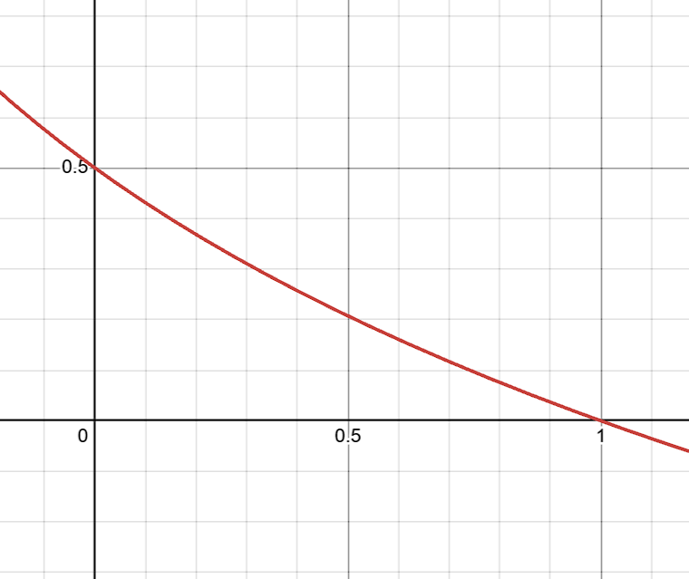
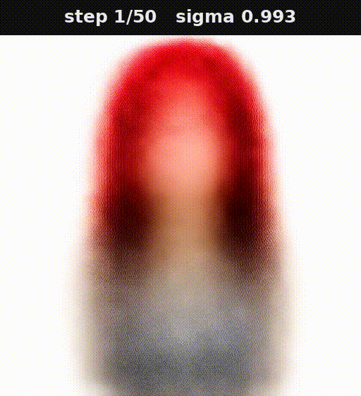
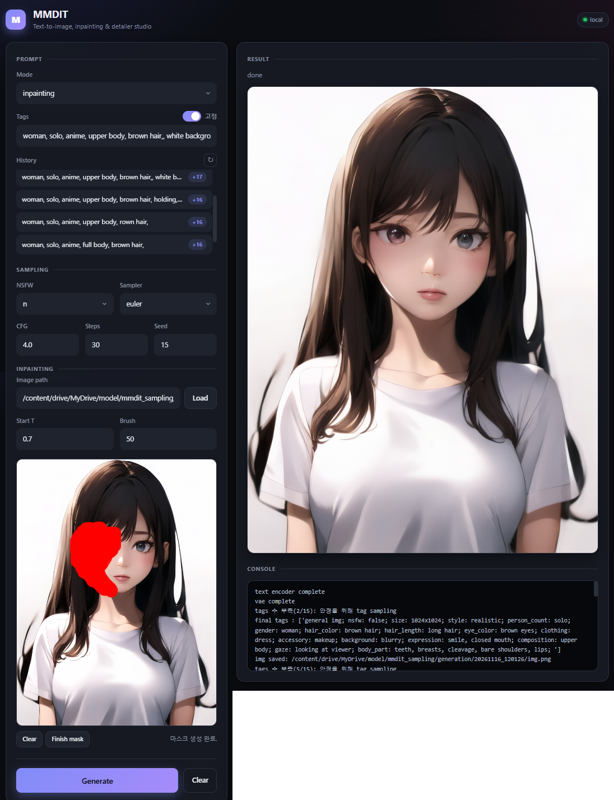

# Diffusion MMDiT Text2img with DC-AE f32c32

## Update — 2026.11.20 Sampling ADD ETA injection Equation selection & Each velocity latents -> img frame save


eta_mode = cosin | ln | sin

ln = eta * ln (2 / (1+x)) / ln 2



code => src.utilities.predict

Image frame save: Collect the latent at each step, decode all latents into images, and save them as an MP4.



## Installation
```bash
python -m pip install -r requirements.txt
```


## Architecture

- **Autoencoder:** DC-AE f32c32 (32× compression, 32 latent channels)
- **Text Encoder:** T5-Large
- **Backbone:** MMDiT with Joint Attention
- **Implementation:** Custom implementation (no pretrained base model)
- **Parameters:** 4B

## Train Environment

- **Framework:** PyTorch (no custom CUDA kernels)
- **GPU:** NVIDIA RTX PRO 6000 (96GB VRAM)
- **Platform:** Google Colab

## Training

### Configuration

- **Batch Size:** Micro-batch 4 × Gradient Accumulation 8 = Effective Batch 32
- **Training Speed:** ~2.3 s / optimizer step
- **Max Resolution:** 1024 × 1024
- **Dataset:** 2M images
- **Objective:** Flow Matching (shift = 3.0)
- **Precision:** BF16
- **Optimizer:** AdamW
- **Learning Rate:** 1e-4
- **EMA:** Enabled

### Training Stages

| Stage | Description | Steps | Patch Size |
|:---:|---|---:|:---:|
| Stage 1 | Pre-training | 600K | 2 |
| Stage 2 | Fine-tuning | 11K | 1 |

**Stage 2 Notes:**
- Reset patch embedding weights.
- Reset output projection weights.

### Loss by Noise Level

| Noise Level | Average Loss |
|:---:|---:|
| 1.0 – 0.9 | 4.0 ~ 4.3 |
| 0.9 – 0.8 | 2.9 ~ 3.1 |
| 0.8 – 0.7 | 2.4 ~ 2.6 |
| 0.7 – 0.6 | 2.0 ~ 2.1 |
| 0.6 – 0.5 | 1.8 ~ 1.9 |
| 0.5 – 0.4 | 1.6 ~ 1.7 |
| 0.4 – 0.3 | 1.3 ~ 1.6 |
| 0.3 – 0.2 | 1.2 ~ 1.4 |
| 0.2 – 0.1 | 1.0 ~ 1.1 |

## Generation Results

### Patch Size 2 + DC-AE f32c32


- **Issue:** Facial features, particularly the eyes, tend to collapse or become distorted.
- **Observation:** Limited spatial detail makes accurate reconstruction of fine facial features challenging.

### Patch Size 1 + DC-AE f32c32


- **Fine-tuning Result:** Fine-tuning with patch size 1 improved facial feature reconstruction.
- **Improvement:** Eye and facial distortions were partially resolved, with better preservation of fine details.

### Current Limitations

- **Full-body Generation:** Full-body generation remains challenging due to insufficient full-body samples in the training dataset.
- **Observation:** The current dataset contains insufficient full-body examples to learn consistent full-body composition and anatomical details.
- **Future Work:** Increase the proportion and diversity of full-body images in the training dataset.

### Train Architecture
- **Use Cache**
- **Cpu Multi Threading**
 


### Inference Architecture


### UI
- **Sampling**


- **Inpainting**



- **Result**


- **GITHUB link** https://github.com/FREEANIMA/DiffusionSampling.git