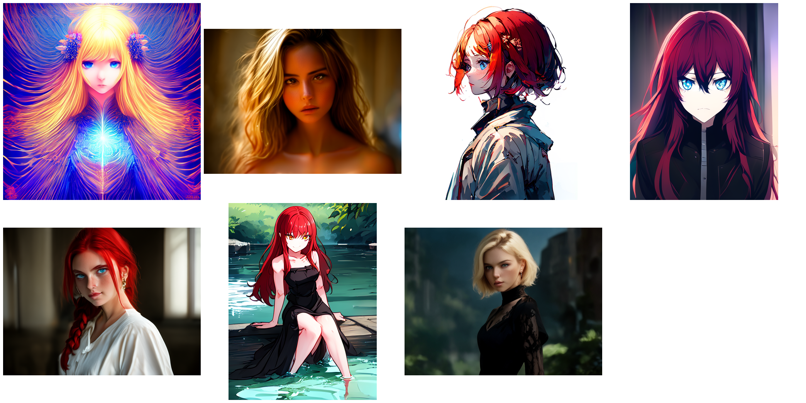

# Diffusion MMDiT Text2img with DC-AE f32c32

## Update — 2026.11.20 Sampling: ETA injection equation selection & per-step latent → frame save


### ETA mode

`eta_mode = cos | ln | sin`

`ln`: `eta * ln(2 / (1 + x)) / ln 2`


Code: `src.utilities.predict`

- `Eta`: 0 is deterministic. The larger it is, the more fresh noise is injected at each step.
- `Eta mode`: schedule of the injected noise over the steps. Selectable in all three tabs.

### Frame save

Collect the latent at every step, decode all of them into images, and save them as an MP4.


Toggle with **Frame save** in the Sampling panel.

### Batch

Generate 1–8 images at once. When Batch is greater than 1, numbered buttons under the result switch between images. Hover over an image to see its seed.

---

## Detailing & Inpainting

Both tabs share the same mask painter with two layers.

| Color | Mode | Meaning |
|-------|------|---------|
| Red | 재생성 (Regen) | Area to redraw |
| Blue | 보존 (Keep) | Area that never changes |
| – | 지우개 (Erase) | Remove paint from both layers |

- Painting one color erases the other under the brush. The later stroke wins, so the layers never overlap.
- If nothing is painted, the whole image (inpainting) or the whole crop (detailer) is redrawn.
- Keep overrides Regen. The final redraw area is `regen × (1 − keep)`.
- Masks are resized to the sampling resolution with nearest-neighbor, so they stay binary.
- **Start T** (0–1): the point in the schedule where redrawing starts. Higher values change more, lower values stay closer to the original. For a full redraw without a mask, around 0.6 is recommended.
- **Brush**: brush size in px.

---

### Inpainting

1. Enter the image path and press **Load**.
2. Paint the Regen / Keep areas on the Original panel.
3. Press **Generate**. The result appears on the right and is saved to `inpainting/`.

The image is fitted so that the long side is 1024 and the short side is snapped to a multiple of `patch_size × compression_ratio`.

### Detailer

1. Enter the image path and press **Load**.
2. Drag a rectangle on the Original panel. The rectangle snaps to multiples of `patch_size × compression_ratio`, and only sizes that scale cleanly to `allowable_size` on the long side are allowed.
3. The selected area appears enlarged in **Crop · Mask**. Paint the Regen / Keep areas there. The label under the crop shows the original size → the enlarged size.
4. Press **Generate**. The crop is redrawn at the enlarged size, scaled back down, and pasted into the original image. The result is saved to `detailer/`.

---

## UI

- Three tabs: **Text2img**, **Inpainting**, **Detailer**. The last tab is remembered, and `#txt2img`, `#inpainting`, `#detailer` in the URL open that tab directly.
- **Tag Browser**: browse and search tags by type, and click to add them to the prompt.
- **Tags autocomplete** and **History**: click a history entry to restore the input plus the expanded tags.
- **고정 (Fixed)** switch: when on, only the entered tags are used and no LLM tag expansion happens.
- Only one job runs at a time. Generation runs in a background thread and the browser polls for the result, so long jobs do not hit proxy timeouts.

## Installation
```bash
python -m pip install -r requirements.txt
```



## Architecture

- **Autoencoder:** DC-AE f32c32 (32× compression, 32 latent channels)
- **Text Encoder:** T5-Large
- **Backbone:** MMDiT with Joint Attention
- **Implementation:** Custom implementation (no pretrained base model)
- **Parameters:** 4B

## Train Environment

- **Framework:** PyTorch (no custom CUDA kernels)
- **GPU:** NVIDIA RTX PRO 6000 (96GB VRAM)
- **Platform:** Google Colab

## Training

### Configuration

- **Batch Size:** Micro-batch 4 × Gradient Accumulation 8 = Effective Batch 32
- **Training Speed:** ~2.3 s / optimizer step
- **Max Resolution:** 1024 × 1024
- **Dataset:** 2M images
- **Objective:** Flow Matching (shift = 3.0)
- **Precision:** BF16
- **Optimizer:** AdamW
- **Learning Rate:** 1e-4
- **EMA:** Enabled

### Training Stages

| Stage | Description | Steps | Patch Size |
|:---:|---|---:|:---:|
| Stage 1 | Pre-training | 600K | 2 |
| Stage 2 | Fine-tuning | 11K | 1 |

**Stage 2 Notes:**
- Reset patch embedding weights.
- Reset output projection weights.

### Loss by Noise Level

| Noise Level | Average Loss |
|:---:|---:|
| 1.0 – 0.9 | 4.0 ~ 4.3 |
| 0.9 – 0.8 | 2.9 ~ 3.1 |
| 0.8 – 0.7 | 2.4 ~ 2.6 |
| 0.7 – 0.6 | 2.0 ~ 2.1 |
| 0.6 – 0.5 | 1.8 ~ 1.9 |
| 0.5 – 0.4 | 1.6 ~ 1.7 |
| 0.4 – 0.3 | 1.3 ~ 1.6 |
| 0.3 – 0.2 | 1.2 ~ 1.4 |
| 0.2 – 0.1 | 1.0 ~ 1.1 |

## Generation Results

### Patch Size 2 + DC-AE f32c32


- **Issue:** Facial features, particularly the eyes, tend to collapse or become distorted.
- **Observation:** Limited spatial detail makes accurate reconstruction of fine facial features challenging.

### Patch Size 1 + DC-AE f32c32


- **Fine-tuning Result:** Fine-tuning with patch size 1 improved facial feature reconstruction.
- **Improvement:** Eye and facial distortions were partially resolved, with better preservation of fine details.

### Current Limitations

- **Full-body Generation:** Full-body generation remains challenging due to insufficient full-body samples in the training dataset.
- **Observation:** The current dataset contains insufficient full-body examples to learn consistent full-body composition and anatomical details.
- **Future Work:** Increase the proportion and diversity of full-body images in the training dataset.

### Train Architecture
- **Use Cache**
- **Cpu Multi Threading**
 


### Inference Architecture


### UI
- **Sampling**


- **Inpainting**


- **Result**


- **GITHUB link** https://github.com/FREEANIMA/DiffusionSampling.git