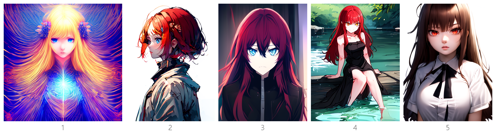
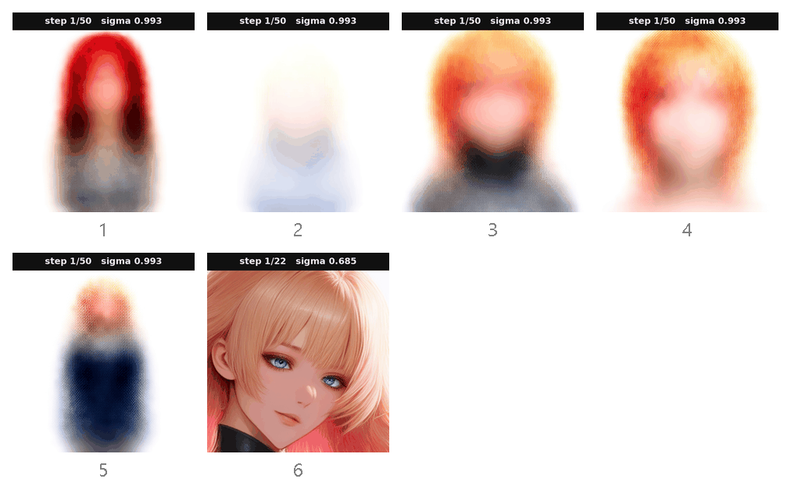

# Diffusion MMDiT Text2img with DC-AE f32c32

| [UPDATE](CHANGELOG.md) | [TRAINSTATE](docs/training.md) | [ARCHITECTURE](docs/architecture.md) | [UI](docs/ui.md) |





## Installation
```bash
git clone https://github.com/FREEANIMA/DiffusionSampling.git
cd DiffusionSampling
python3 -m venv .venv
source .venv/bin/activate
python -m pip install -r requirements.txt
python main.py
```

## Architecture

- **Autoencoder:** DC-AE f32c32 (32× compression, 32 latent channels)
- **Text Encoder:** T5-Large
- **Backbone:** MMDiT with Joint Attention
- **Implementation:** Custom implementation (no pretrained base model)
- **Parameters:** 4B

---


### Training Stages

| Stage | Description | Steps | Patch Size |
|:---:|---|---:|:---:|
| Stage 1 | Pre-training | 600K | 2 |
| Stage 2 | Fine-tuning | 11K | 1 |

**Stage 2 Notes:**
- Reset patch embedding weights.
- Reset output projection weights.

---

### Current Limitations

- **Full-body Generation:** Full-body generation remains challenging due to insufficient full-body samples in the training dataset.
- **Observation:** The current dataset contains insufficient full-body examples to learn consistent full-body composition and anatomical details.
- **Future Work:** Increase the proportion and diversity of full-body images in the training dataset.

- **GITHUB link** https://github.com/FREEANIMA/DiffusionSampling.git
